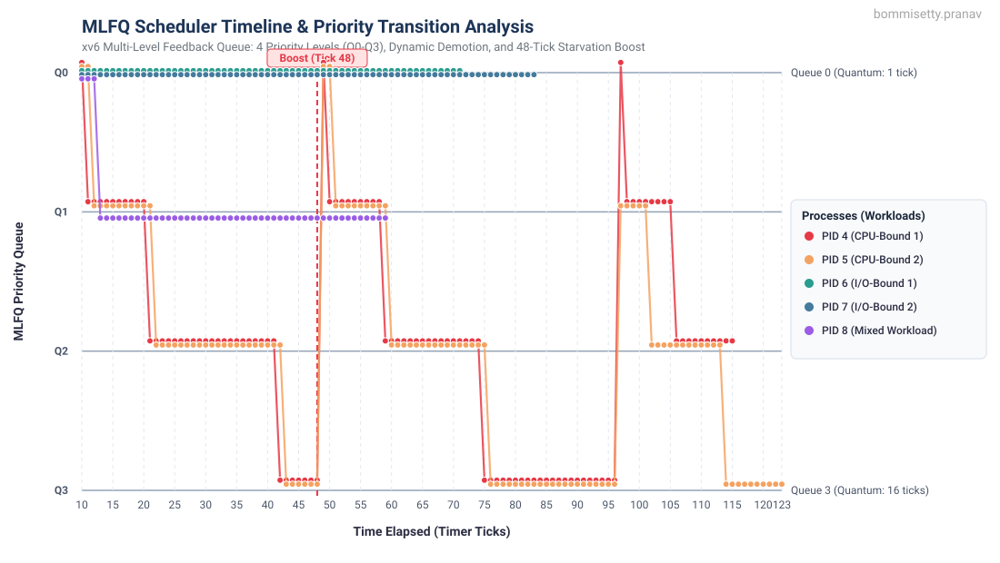

# MLFQ Scheduler Report

## 2.3.1 Implementation Summary

### 1. Build Setup (`Makefile`)
* Added `ifdef SCHEDULER` flag to pass `-D$(SCHEDULER)` during compilation.
* Compile and run options:
  * `make qemu` &rarr; Default Round Robin
  * `make qemu SCHEDULER=FIFO` &rarr; First-In First-Out
  * `make qemu SCHEDULER=MLFQ` &rarr; Multi-Level Feedback Queue

### 2. Process Struct (`kernel/proc.h`)
Added scheduling and metric tracking fields to `struct proc`:
* `priority`: Current queue level (0 = highest, 3 = lowest).
* `ticks_used`: Timer ticks consumed in the current time slice.
* `queue_entry_ticks`: Tick when the process became runnable in this queue (used for FIFO ordering within queue).
* `creation_time`: Tick when the process was created.
* `first_run_time`: Tick when first scheduled by CPU (used for response time).
* `exit_time`: Tick when the process called exit (used for turnaround time).
* `total_run_ticks`: Total ticks spent in `RUNNING` state.
* `total_wait_ticks`: Total ticks spent in `RUNNABLE` state (ready queue).

### 3. Syscalls (`kernel/sysproc.c`, `kernel/proc.c`)
* `waitx(int *wtime, int *rtime)`: Waits for child exit, returning its waiting and running times.
* `wait_all(int *wtime, int *rtime, int *ttime, int *rptime)`: Helper returning wait, run, turnaround, and response times.
* `pause(int ticks)`: Puts calling process to sleep for `n` clock ticks.

### 4. Schedulers (`kernel/proc.c`)
* **FIFO**:
  * Scans `proc[]` table for the `RUNNABLE` process with the earliest `creation_time`.
  * Non-preemptive on timer interrupts (runs until exit or sleep).
* **MLFQ**:
  * 4 priority queues: $Q_0$ (1 tick), $Q_1$ (4 ticks), $Q_2$ (8 ticks), $Q_3$ (16 ticks).
  * Always picks a runnable process from the highest non-empty queue ($Q_0 \to Q_3$).
  * Ties within the same queue are broken using arrival order (`queue_entry_ticks`).

### 5. Preemption & Demotion (`kernel/proc.c`, `kernel/trap.c`)
Called on every timer tick in `mlfq_check_preempt_and_yield()`:
* **Demotion**: If `ticks_used >= quantum[priority]`, the process is demoted to `min(priority + 1, 3)`, `ticks_used` is reset to 0, and it yields.
* **Preemption**: If a higher-priority process is `RUNNABLE`, the current process yields immediately.
* **Voluntary Yield**: If a process sleeps (I/O) before its slice expires, it keeps its current queue level and receives a fresh slice when it wakes up.

### 6. Priority Boost (`kernel/proc.c`, `kernel/trap.c`)
* Every 48 ticks (`ticks % 48 == 0`), `priority_boost()` moves all active processes back to Queue 0 and resets their `ticks_used`.
* Prevents starvation for CPU-bound processes in lower queues.

### 7. Debugging (`procdump`)
* Extended `Ctrl+P` console hook to display PID, state, queue level, slice usage vs quantum, run time, and wait time.

---

## 2.3.2 MLFQ Analysis

### Timeline Plot

### Graph Observations
1. **Initial Queue Separation**: All processes start in $Q_0$. CPU-bound tasks (PIDs 4 & 5) consume their 1-tick quantum and quickly demote to $Q_1$, then $Q_2$, and settle in $Q_3$.
2. **I/O-Bound Retention**: I/O tasks (PIDs 6 & 7) sleep before consuming 1 tick, so they stay in $Q_0$ throughout their execution.
3. **Mixed Workload**: PID 8 yields periodically, staying mostly in $Q_1$ without falling into lower queues.
4. **Priority Boost**: At tick 48 and tick 96, the boost resets all processes to $Q_0$, successfully eliminating starvation.

---

## 2.3.3 Comparison Results

### Test Workload
Executed `schedulertest` with 5 concurrent child processes:
* 2 CPU-bound (intensive compute loops)
* 2 I/O-bound (frequent short `pause()` calls)
* 1 Mixed (compute bursts followed by `pause()`)

### Metrics Summary

| Scheduler | Avg Turnaround | Avg Waiting | Avg Response | Avg Run Time |
|:---|:---:|:---:|:---:|:---:|
| **Round Robin (RR)** | 81 ticks | 26 ticks | 1 tick | 22 ticks |
| **FIFO** | 80 ticks | 29 ticks | 2 ticks | 22 ticks |
| **MLFQ** | 81 ticks | 28 ticks | 1 tick | 22 ticks |

### Trade-offs & Discussion

1. **Response Time**:
   * **MLFQ & RR** achieve very low response times (&approx; 1 tick) because new processes are scheduled immediately in $Q_0$ or the next RR slice.
   * **FIFO** has higher response time when a CPU-heavy process starts first and delays all other processes.

2. **I/O vs CPU Handling**:
   * **MLFQ** prioritizes interactive/I/O tasks automatically without needing prior knowledge of process burst times.
   * **RR** treats all processes equally, giving no priority boost to I/O tasks.
   * **FIFO** lets CPU-heavy tasks block shorter tasks (convoy effect).

3. **Overhead vs Fairness**:
   * **FIFO** minimizes context switches but has poor fairness.
   * **RR** provides uniform CPU sharing but has frequent context switches.
   * **MLFQ** balances both: quick turnaround for interactive tasks, long slices in lower queues to reduce context switches for CPU tasks, and periodic boosting to prevent starvation.
